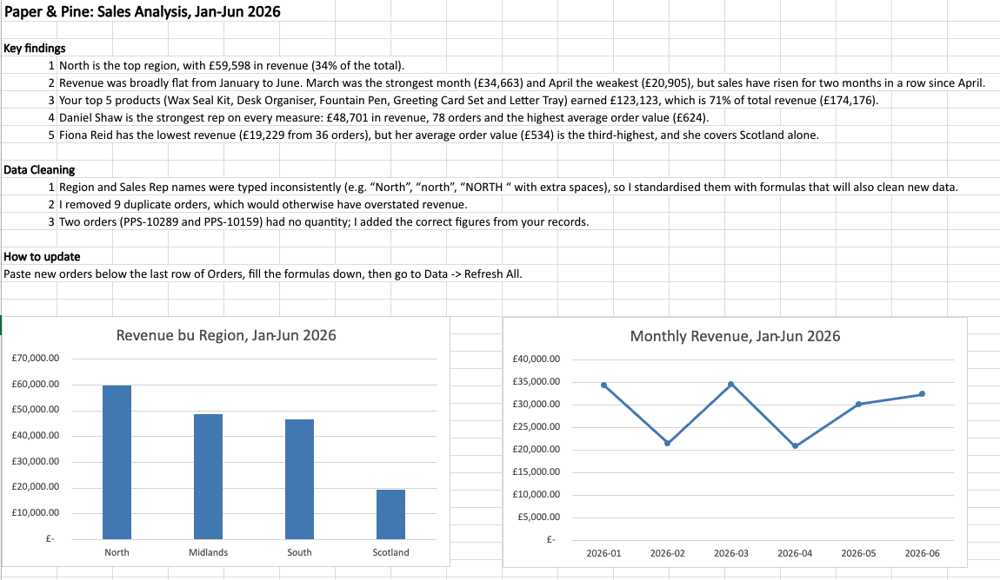

# Paper & Pine: Sales Cleaning and Pivot-Table Analysis (Excel)

> **Practice case study.** Paper & Pine is a fictional UK stationery wholesaler and the data is synthetic. The brief, the problems in the data and the deliverable copy a typical Upwork Excel job.

## The brief
The client sent a January–June 2026 order export (320 orders after cleaning, 12 products, 6 sales reps, 4 regions) and asked four questions:
1. What is total revenue by region?
2. What is revenue by month? Is the business growing?
3. Which are the top 5 products by revenue?
4. What is each sales rep's revenue and average order value?

Revenue = Qty × Unit Price × (1 − Discount). The deliverable had to be a formula-based Excel workbook (no macros) that the client's team can update.

## Data problems found and fixed
| Problem | Fix |
|---|---|
| Region typed inconsistently (`North`, `north`, `NORTH`, `North `) | `=PROPER(TRIM())` helper column |
| Sales rep names with trailing spaces | `=PROPER(TRIM())` helper column |
| 9 orders entered twice | Found with `COUNTIF`, then removed with Remove Duplicates |
| 2 orders with no quantity | Confirmed with the client and filled from their records |

## Method
- Prices and product names brought in from the Products sheet with `XLOOKUP`
- Revenue column `=Qty*UnitPrice*(1-Discount)` and a Month column `=TEXT(date,"yyyy-mm")`
- Four pivot tables: revenue by region, by month, top products, and rep performance (sum, average and count)
- A one-page **Summary** sheet with the key findings, "how to update" notes, and two pivot charts (revenue by region and monthly revenue)

## Key findings
- **North** is the top region: £59,598 (34% of £174,176 total revenue).
- Revenue was **broadly flat** from Jan to Jun (Q2 about 8% below Q1), with dips in February and April and **two months of growth** since April.
- The **top 5 products** earn **71%** of revenue, led by higher-priced items (Wax Seal Kit, Desk Organiser, Fountain Pen).
- **Daniel Shaw** leads on every measure (£48,701, 78 orders, £624 average order). **Fiona Reid** has the lowest total, but the third-highest average order, and covers Scotland alone.

## Files
- `data/raw/PaperPine_Orders_Jan-Jun2026.xlsx`: the original client file (untouched)
- `PaperPine_Analysis.xlsx`: cleaned data, pivot tables and Summary sheet

## Tools
Microsoft Excel (Excel for the web): TRIM, PROPER, COUNTIF, XLOOKUP, TEXT, Remove Duplicates, PivotTables. Version control with git.
